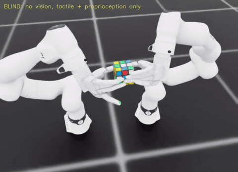
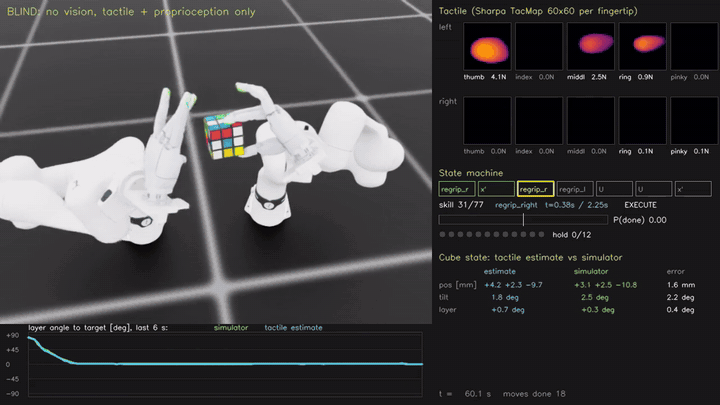
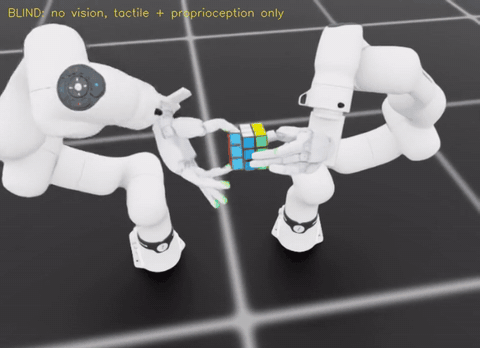
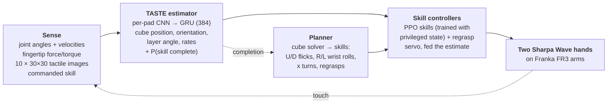

<div align="center">

# TASTE

### Tactile Articulated STate Estimation

**Solve a Rubik’s cube by touch.**

Two dexterous hands estimate the cube’s pose and its turning layer from fingertip touch and joint angles alone,<br>
and solve it with no camera in the loop.

[](https://johnny-lauhm.github.io/TASTE-Tactile-Articulated-STate-Estimation/)
[](#-citation)
[](LICENSE)
<br>




<sub>Simulation (Isaac Lab), 2× speed. Two Sharpa Wave SE hands on Franka FR3 arms. The controllers see only the touch-based estimate; the simulator’s state is used for scoring.</sub>

</div>

---

## ✨ Highlights

<table>
<tr>
<td align="center" width="33%"><h2>83.2%</h2>of 256 held-out scrambles solved <b>blind</b> in nominal simulation<br><sub>(90.6% with privileged vision)</sub></td>
<td align="center" width="33%"><h2>0.3°</h2>median error of the turning layer’s angle, felt through the fingertips<br><sub>(position 1.6 mm, orientation 1.4°)</sub></td>
<td align="center" width="33%"><h2>77 skills</h2>in one solve, all chosen and finished on the estimate<br><sub>(flicks, wrist rolls, cube turns, regrasps)</sub></td>
</tr>
</table>

## 🎬 Demo

**What the robot feels, and what it believes.** The dashboard shows the ten fingertip tactile images, the skill state
machine with its completion probability, and the touch estimate of the cube next to the simulator’s ground truth.

<p align="center">
  
</p>

<table>
<tr>
<td width="50%"></td>
<td width="50%">

**…and the cube is solved.** The end of a full blind solve: 77 skills in 151 s of simulated time, every skill
triggered by the estimator’s own completion head.

▶️ Full-length videos are on the [project page](https://johnny-lauhm.github.io/TASTE-Tactile-Articulated-STate-Estimation/#watch).

</td>
</tr>
</table>

## 🧠 How it works

**Feel. Estimate. Act on the estimate.**



- **Estimator in the loop.** The estimator is trained on rollouts driven by its own estimates (DAgger-style: control on
  the true state is annealed to zero), so it learns from the states its own errors create.
- **No privileged shortcuts at run time.** Every controller reads the cube through `SolveEnv.perceived()`; blind runs
  advance on the estimator’s completion head, and the simulator’s state only scores the result.
- **Reliability-aware planning.** Face turns are compiled into the hands’ skill alphabet, choosing the sequence with the
  lowest expected failure.

## 📊 Results

Full solves of **256 random scrambles** per entry, frozen system, 95% Wilson intervals.

| Condition | Scrambles | Sighted (privileged state) | **Blind (TASTE)** |
|---|---|---|---|
| Nominal | held-out | 90.6% [86.4, 93.6] | **83.2%** [78.1, 87.3] |
| Nominal | development | 89.5% [85.1, 92.6] | **78.9%** [73.5, 83.5] |
| Randomized | held-out | 57.0% [50.9, 62.9] | **39.5%** [33.7, 45.6] |
| Randomized | development | 60.5% [54.4, 66.3] | **44.5%** [38.6, 50.7] |

*Randomized:* observation noise and sensor offsets, friction, masses, gains and command latency are randomized per episode.

**Estimation accuracy** (closed loop, randomized training distribution):

| Cube position | Cube orientation | Layer angle | Completion |
|:---:|:---:|:---:|:---:|
| **1.6 mm** (p90 3.2) | **1.4°** (p90 3.1) | **0.3°** (p90 1.2) | precision **0.95** / recall **0.98** |

## 🤖 Toward the real hand

- **Measured latency.** Step responses on the real Sharpa Wave SE show about 20 ms from command to motion. With that
  latency in simulation, the sighted system still solves 85.5% (nominal 90.6%); the blind system drops to 61.3%
  (nominal 83.2%). Touch-based estimation is the latency-sensitive part.
- **Tactile delivery.** The real sensor refreshes at about 30 Hz; delivering touch 50 / 100 ms late lowered blind solves
  under randomization from 43% to 36% / 25% in an earlier system.
- **Built-in sim-to-real switches** (all off by default, `env_cfg.py`): `obs_real`, `dr`, `dr_hand_delay`,
  `tac_rate_p` / `tac_lag`, and `cube_vis`, a camera-measurement baseline with `execute.py --trigger vision`.

## ⚠️ Limitations

- **Simulation only.** No real-robot result yet.
- **An idealized cube.** Layers snap into line when the grip changes faces; a separately jointed middle layer or layers
  that jam when out of line cut the solve rate sharply.
- **Under audit.** The blind system’s cube orientation is re-anchored to the simulator’s value at each skill start, so
  the blind numbers may be optimistic. The fix (`goal_from_perceived`) is in the code; the corrected evaluation is pending.

## 📁 Repository layout

```
source/rubik_lab/rubik_lab/
  solve/env.py, env_cfg.py   SolveEnv (DirectRLEnv): skills, completion, sim-to-real switches
  solve/estimator.py         the TASTE estimator (CubeEstimator, Estimator wrapper)
  solve/cube_logic.py        hand-frame cube logic, solver, skill compiler
  wave_se_tactile.py         Sharpa Wave SE tactile model (TacMap images, pad F/T)
  fr3_arm.py, assets.py      FR3 + Wave SE articulation configs
scripts/solve/               train.py (RL), train_estimator.py, execute.py (full solves), replay.py (dashboard videos)
scripts/franka/              building the FR3 + Sharpa Wave assets
launch/                      launchers used for the reported runs
tests/                       unit tests (cube logic, binding, ...)
assets/                      cube USD, Sharpa TacMap maps, robogym reference cube
media/                       README demos
```

## 🛠️ Setup

```bash
bash scripts/setup_env.sh          # conda env `sharpa`: Isaac Sim 5.1, Isaac Lab v2.3.2, torch 2.7 cu128, rsl-rl
conda activate sharpa
export OMNI_KIT_ACCEPT_EULA=YES
python -m pytest -q tests/test_solve_logic.py
```

**Not included:** robot assets (Sharpa Wave SE from
[sharpa-urdf-usd-xml](https://github.com/sharpa-robotics/sharpa-urdf-usd-xml) and the Franka FR3 description, both
Apache-2.0), trained checkpoints, ready-grip caches (`cache/`) and run logs. `scripts/franka/` builds the arm + hand
USDs; the generated `.usda` files reference absolute paths that must be regenerated on a new machine.

## 🚀 Usage

```bash
# sighted full solves (privileged state)
SEED=21 launch/fr3_exec2.sh <teacher.pt> outputs/solve/sighted 256

# blind full solves with a TASTE estimator
TEACHER=<teacher.pt> DONE_HOLD=12 bash scripts/solve/blind_solve.sh <estimator.pt> outputs/solve/blind 256 \
  --set "contact_model='tacmap'" --timeout_continue --redo_missed

# train the estimator in the loop
TEACHER=<teacher.pt> RESUME=<estimator.pt> OUT=logs/estimator/mine launch/fr3_est1.sh --set obs_real=True --set dr=True

# render a dashboard video of a recorded run
python scripts/solve/replay.py --help
```

## 📝 Citation

The paper is in preparation. Until then, please cite the repository:

```bibtex
@misc{taste2026,
  title  = {TASTE: Tactile Articulated State Estimation for Blind Bimanual Rubik's Cube Solving},
  author = {Lau, Johnny},
  year   = {2026},
  howpublished = {\url{https://github.com/Johnny-lauHM/TASTE-Tactile-Articulated-STate-Estimation}}
}
```

## 📄 License

The code is released under the [MIT License](LICENSE). Bundled third-party files keep their own licenses:
`assets/tacmap_maps/` (Sharpa TacMap, Apache-2.0, see its LICENSE and NOTICE) and `assets/reference/robogym/`
(OpenAI robogym, MIT).
